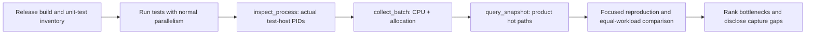

# .NET Diagnostics MCP

## Trigger On

- The user asks to install or use `dotnet-diagnostics-mcp` for .NET performance investigation.
- The user asks: **"Profile all unit tests and identify bottlenecks in the code tested."**
- An MCP-connected agent needs runtime evidence for CPU hotspots, allocation pressure, GC pauses, or waiting in a .NET application.

Use this skill for this MCP server's workflow. Use the test framework's guidance for assertions and test authoring, and a benchmark workflow when the question needs precise per-operation timing.

## Install and Connect

```bash
dotnet tool install -g dotnet-diagnostics-mcp
# If already installed:
dotnet tool update -g dotnet-diagnostics-mcp
dotnet tool list -g
```

Register `dotnet-diagnostics-mcp` with arguments `["--stdio"]` in the client's native MCP settings, then reload its MCP connection. The client starts and owns the server subprocess; local stdio needs no HTTP daemon or bearer token. Ensure the client can resolve the global-tool command on `PATH`.

For example, Claude Desktop / Cursor-style configuration:

```json
{
  "mcpServers": {
    "dotnet-diagnostics": {
      "command": "dotnet-diagnostics-mcp",
      "args": ["--stdio"]
    }
  }
}
```

Check `tools/list` for `inspect_process`, `collect_batch`, `collect_sample`, `collect_events`, and `query_snapshot`. Installing the tool alone does not connect it to the current AI session. If startup rejects symlink/reparse-point paths, set the server's `MCP_ARTIFACT_ROOT` environment variable to an existing writable directory whose full path has no symlinks; see [tool patterns](references/tool-patterns.md).

## Workflow

1. Identify the requested workload, runtime, test runner, and unit-test projects. Build Release binaries with matching PDBs before the measured run. Keep build/restore time separate from test execution.
2. For all-unit-test requests, follow [test profiling](references/test-profiling.md): inventory projects, retain normal test parallelism, start the suite, and discover the actual test host or application process by command line. Record every relevant PID and its capture window.
3. Resolve an explicit `processId` with `inspect_process(view="list", commandLineContains=...)`. Use `view="info"` to verify its identity. For a long-lived app, `view="triage"` can choose the next collector; avoid spending a short test host's lifetime on preliminary captures.
4. Capture CPU and managed allocations together with `collect_batch`; optionally add GC and counters, up to four entries. Use `depth="compact"` and read the returned digest and per-entry errors before querying handles.
5. Follow the hot path into the code under test. Separate product methods from runner, fixture, mocking, assertion, JIT, and profiler overhead. Use [tool patterns](references/tool-patterns.md) for collector selection and evidence limits.
6. Reproduce a suspected hotspot with the runner's native test filter, preserving unrelated parallel execution. Compare equal workload, runtime, configuration, concurrency, and capture duration. Change code only within the user's requested scope, then rerun correctness checks and the same profile.



## Practical MCP Calls

These are MCP tool arguments, not shell commands. Replace the illustrative PID and handle with values returned by the server.

Collect a bounded profile of a running test host with `collect_batch`:

```json
{
  "processId": 4242,
  "durationSeconds": 10,
  "depth": "compact",
  "requests": [
    { "tool": "collect_sample", "kind": "cpu" },
    { "tool": "collect_sample", "kind": "allocation" }
  ]
}
```

Read the CPU or allocation handle's call tree with `query_snapshot`:

```json
{
  "handle": "<returned-handle>",
  "view": "call-tree",
  "topN": 10,
  "maxDepth": 8,
  "maxNodes": 40,
  "depth": "compact"
}
```

## Deliver

- Record tool/runtime versions, test command, configuration, normal concurrency, projects and test counts, PID identities, capture windows, and test exit status.
- Rank bottlenecks by measured evidence: product method and source location when available, sample share or allocated-byte signal, affected test group, interpretation, and a concrete next change or measurement.
- Report test-harness overhead separately. State missing hosts, missed execution intervals, failed collectors, unresolved symbols, and sampling limits. A passing suite and one captured PID do not prove every test was profiled.
- Preserve useful bounded artifacts or exported traces and their paths. Handles expire and normally belong to the current MCP server session.

## Validate

- Confirm the MCP connection and advertised tool schemas; use current tool names and supported argument values.
- Confirm samples came from the test host or app being tested, rather than the build process or SDK wrapper.
- Check each batch entry for errors and verify the measured window overlaps real test execution. An empty profile is inconclusive.
- Attribute EventPipe CPU results as stack-frequency evidence and allocation results as sampling evidence. Validate suspected waiting with counters, contention events, or a supported blocking collector.
- Retain native test progress and ANSI. Show Warning/Error diagnostics plus one concise result; cap each diagnostic response at 80 lines / 8 KiB, preserve the runner exit code, and keep necessary artifacts size-bounded outside model context.

Source: [dotnet-diagnostics](https://github.com/pedrosakuma/dotnet-diagnostics). Read [test profiling](references/test-profiling.md) for suite coverage and [tool patterns](references/tool-patterns.md) for setup, drilldown, settings, and source links.
