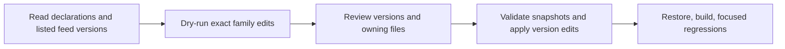

# NuGet Package Manager

## Trigger On

- Checking outdated NuGet declarations with `nuget-manager`.
- Reviewing or applying one package family, such as `Microsoft.Orleans`, across projects and Central Package Management files.
- Using the ManagedCode NuGet Package Manager extension in VS Code.

## Workflow

1. Install the public tool and confirm its current help.
2. Select a workspace, family, policy and prerelease scope; check feeds and preview exact edits.
3. Review the owning files and target versions, apply the authorized selection, then restore, build and run focused regressions.

### Install

```sh
dotnet tool install --global nuget-manager
nuget-manager --help
```

For an existing installation, use `dotnet tool update --global nuget-manager`. This is a global tool, not an application `PackageReference`. The [upstream repository](https://github.com/managedcode/NuGetPackageManager) publishes both the tool and a VS Code extension. Install the extension from the [Marketplace](https://marketplace.visualstudio.com/items?itemName=managedcode.managedcode-nuget-package-manager) or a released VSIX.

### Inspect and Review

Run a read-only family check, then preview exact proposed edits:

```sh
nuget-manager check --path . --family Microsoft.Orleans --policy minor --json
nuget-manager update --path . --family Microsoft.Orleans --policy minor --dry-run --json
```

`Microsoft.Orleans` selects the exact ID and dot-boundary descendants, never `Microsoft.OrleansExtra`. Each package keeps its own available target version; selecting a family does not force a shared version or establish compatibility. Inspect every target version and owning file, including central declarations consumed by multiple projects.

### Apply and Validate

After reviewing the preview, apply the same selection:

```sh
nuget-manager update --path . --family Microsoft.Orleans --policy minor --yes
git diff -- '*.csproj' '*.fsproj' '*.vbproj' 'Directory.Packages.props'
dotnet restore
dotnet build --no-restore
dotnet test --no-build
```

Use `--yes` only when writing that selection is authorized. Without it, `update` uses the interactive review. Run the repository's focused regressions after restore/build; keep unrelated tests parallel and respect the repository's test-output budget. The tool does not restore or test automatically. If a file changed since the review snapshot, refresh and review again before applying.



## Options and Editor Workflow

- `--policy latest` accepts any numerically newer version; `minor` stays within the current major; `patch` stays within the current major and minor. Version numbers do not prove API compatibility.
- Stable versions are the default. Add `--prerelease` intentionally when preview versions are required.
- `--source https://api.nuget.org/v3/index.json` adds a NuGet V3 feed. A failed configured feed remains an incomplete check; never interpret it as up to date.
- Use `--path` to bound the workspace and `--json` for machine-readable output.
- In VS Code, open **NuGet: Open NuGet Package Manager** for the sidebar or **NuGet: Open NuGet Package Manager in Editor** for the wide workbench. Choose Groups/List, select a family or declarations, review native diffs, and apply in a trusted workspace.
- `nugetPackageManager.autoCheck` defaults to true. Automatic checks may reuse successful version lists for ten minutes; **Check for Updates** queries the feeds again. Existing unsaved document edits remain unsaved after version updates.

## Constraints

- Supported: literal `PackageVersion` entries in `Directory.Packages.props`, literal `PackageReference` versions, and explicit `<Sdk Name="..." Version="..." />` declarations in C#, F#, and VB project files.
- An existing `Aspire.AppHost.Sdk` declaration participates in the `Aspire` family. Versionless SDKs are unchanged; no SDK is added.
- Property expressions, ranges, wildcards, invalid XML, and unsupported versions require manual handling. `Project Sdk="Name/version"`, `Import` SDKs, and SDK versions in `global.json` are outside this tool's scope.
- The manager does not add/remove package references, resolve dependency compatibility, implement NuGet.config source mapping, or authenticate to private feeds. Keep credentials out of source settings.
- Conditional declarations remain independently selectable. Changing a central version affects every consuming project.

## Deliver

Report the chosen family, policy and prerelease scope, reviewed files and versions, applied diff, and restore/build/regression results. Distinguish a failed feed check from a successful check with no updates.

## Validate

- Confirm installed help matches the commands before automation.
- Confirm the dry-run leaves version files unchanged and the apply diff contains only reviewed literal versions.
- Confirm stale reviews are refreshed and unsupported declarations remain explicit.
- Confirm focused consumer regressions pass after restoring the changed versions.

## Sources

- [CLI setup and option contract](https://github.com/managedcode/NuGetPackageManager/blob/main/docs/Development/Setup.md)
- [Supported package and SDK update behavior](https://github.com/managedcode/NuGetPackageManager#supported-scope-and-limits)
- [Public releases](https://github.com/managedcode/NuGetPackageManager/releases)
